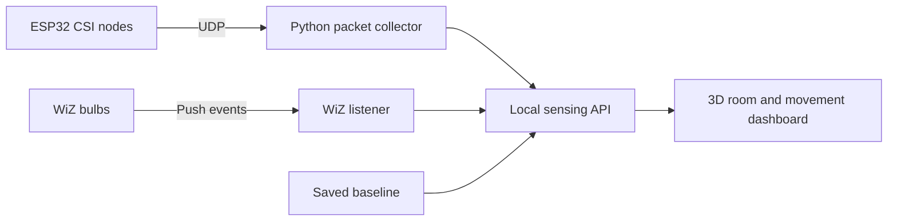

# RuView Bedroom

A personal adaptation of [ruvnet/RuView](https://github.com/ruvnet/RuView) connecting ESP32 Wi-Fi sensing, WiZ occupancy events and an interactive bedroom model. Customized by [Aryaman Mittal](https://github.com/aryamanmittal24), with AI-assisted implementation and hardware debugging.

**My contribution is the local bedroom experience and integration layer.** The upstream RuView firmware, research platform and wider codebase belong to their original contributors. Their source and license notices are retained.

## What I changed

- Built an interactive 3D bedroom from reference photos and approximate dimensions, with camera controls and a clearly labeled room-wide activity indicator.
- Connected ESP32 CSI packets to a small Python API and dashboard, including live signal freshness and offline states.
- Added WiZ event registration and diagnostics that distinguish a connected bulb, a heartbeat and an actual occupancy event.
- Added saved baseline calibration and movement-learning code, including handling of stale signals and expired WiZ events.
- Reduced the dashboard navigation to the relevant local features instead of presenting disconnected demo panels as working capabilities.

## Architecture



## What the hardware work established

The two ESP32-S3 boards were identified over USB and flashed with matching 16 MB firmware layouts. Node 2 joined Wi-Fi and delivered CSI data to the Mac. WiZ bulbs accepted push registration and delivered heartbeats. That proves the transport paths; it does not establish accurate room occupancy or localization.

SpaceSense calibration showed processor responses to hand movement in the WiZ app, but reliable motion events reaching the custom bridge were not established in the recorded test. Device placement, fan movement and activity behind an adjacent wall remain sources of uncertainty.

## Honest limits

- This setup displays room-wide signal changes; it does not place people or pets at measured 3D coordinates.
- Two receivers alone do not establish calibrated positioning or reliable separation of two moving subjects.
- A through-wall signal cannot be assumed to stop at the bedroom boundary.
- Baseline calibration is installation-specific. Moving hardware or changing the environment requires revalidation.
- Upstream pose and vital-sign capabilities are not claims of validation in this bedroom. Medical accuracy has not been established.

## Run and inspect

See [personal setup instructions](PERSONAL_SETUP.md) for the collector, WiZ listener, server and firmware configuration. Open http://127.0.0.1:3000/#room-map after starting the services. Personal credentials, calibration captures, firmware backups and photos are excluded.

- [Case study and development milestones](docs/BEDROOM_CASE_STUDY.md)
- [Custom changes against upstream](docs/BEDROOM_CHANGES.md)
- [Actual commit history](https://github.com/aryamanmittal24/ruview-bedroom/commits/main/)
- [Original upstream README](https://github.com/ruvnet/RuView/blob/dd02efe/README.md) — broader project documentation and claims.

Publication checks: **5 movement-learning tests passed on 15 November 2026**; the room-map JavaScript files also passed syntax checks. These focused checks do not validate every subsystem in the retained upstream tree.

```sh
python3 -m unittest discover -s scripts/tests -p test_movement_learning.py
node --check ui/components/RoomMap.js
node --check ui/components/BedroomScene.js
```

## Provenance

Source snapshot based on upstream commit `dd02efe` (full revision in `PERSONAL_SETUP.md`). This repository is a customized source snapshot, not a GitHub fork. Git history starts with the publication snapshot; earlier local work is described as milestones, not backdated commits. Original RuView licensing applies to its retained source. AI assistance is disclosed rather than presented as unaided authorship.
