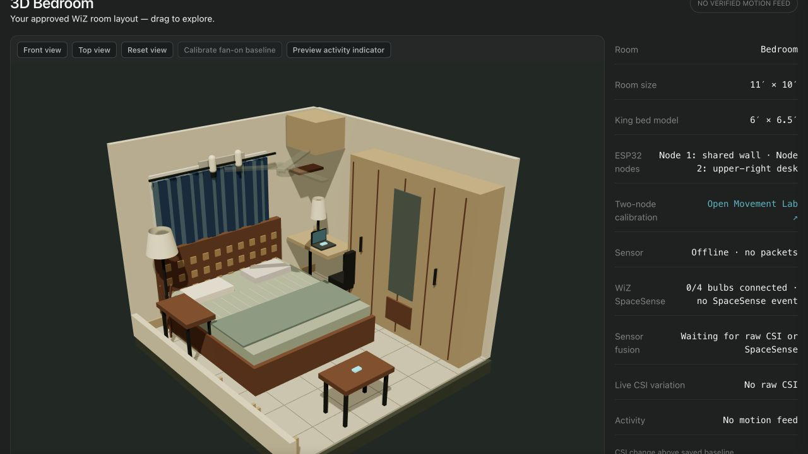
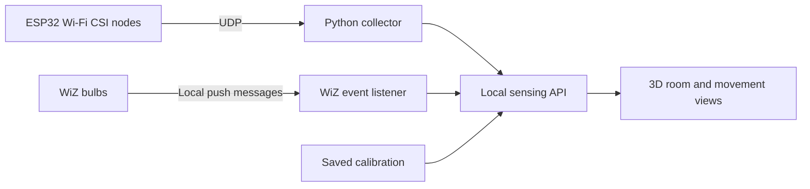

# RuView Bedroom

**An experiment in making my room respond to more than a button press.**

After building a dashboard for my WiZ lights, I wanted to explore sensing: could the Wi-Fi hardware already around me tell when something was moving in the room? I found [RuView](https://github.com/ruvnet/RuView), connected ESP32 boards, and started building a small, room-specific dashboard around it.

This repository contains my adaptation of RuView: ESP32 data collection, a WiZ event bridge, baseline calibration, and a 3D model of my bedroom. It is a hands-on sensing experiment with working data paths and real limitations to work through.

[My changes](docs/BEDROOM_CHANGES.md) · [Build story](docs/BEDROOM_CASE_STUDY.md) · [Setup](PERSONAL_SETUP.md) · [Commits](https://github.com/aryamanmittal24/ruview-bedroom/commits/main/)


*The actual room dashboard. The sensors were offline when this screenshot was captured, so the interface shows unavailable readings. The model is a visual reference; it does not establish a person's position.*

## Why I did it

The lighting project gave me a way to control the room. This project began with a different question: what could the room sense?

I wanted something I could test in everyday situations—sitting at the desk, walking in, leaving the fan on, or having a cat move around. Those tests quickly became more useful than an impressive demo. A motion score could stay high while I was still. Movement behind a wall might affect the signal. A connected smart bulb might send heartbeats without sending occupancy events.

That is what kept the project interesting: figuring out which part was actually working, and making the dashboard honest about the rest.

## What I built on top of RuView

| Part | My adaptation |
| --- | --- |
| **3D bedroom** | A room model based on my photos and approximate measurements, with orbit controls and sensor markers. |
| **ESP32 data path** | Local packet collection and an API feeding the dashboard, including freshness and offline handling. |
| **WiZ integration** | Push registration and diagnostics that distinguish bulb connectivity, heartbeats and occupancy events. |
| **Calibration** | Saved signal baselines and a two-node movement workflow, with checks for stale data. |
| **A smaller dashboard** | Room and movement views focused on the local setup rather than a collection of disconnected demos. |

The upstream RuView team built the wider sensing platform and firmware. My contribution is this room-specific integration, interface and experimental workflow. The [file-by-file comparison](docs/BEDROOM_CHANGES.md) makes that boundary explicit.

## One change that mattered: removing the location dot

An early version put a red activity marker on the floor of the 3D model. It looked like a location estimate, even though the available signal only indicated room-wide change.

I replaced it with a labeled activity status. That was an important lesson for this project: a visualization can imply more certainty than the measurement supports. A convincing room model should not make an uncertain signal look precise.

## How the pieces connect



CSI—Channel State Information—describes aspects of a received Wi-Fi signal. Movement can change those measurements. The collector summarizes signal variation, and the host compares it with a saved baseline. WiZ occupancy events are another potential input, when SpaceSense is configured and actually producing events.

## What worked in the recorded tests

- Identified and flashed two ESP32-S3 boards, checking their flash and RAM configuration first.
- Backed up the second board's original firmware, provisioned it as Node 2, and verified CSI arriving at the Mac.
- Registered the powered WiZ bulbs for local push messages and received heartbeats.
- Observed the WiZ app's calibration graph respond to hand movement.
- Added persistent calibration and stale-event handling instead of carrying old readings forward indefinitely.

**What is still experimental:** reliable WiZ occupancy events reaching this custom bridge, distinguishing bedroom movement from movement behind an adjacent wall, and consistent movement detection across different conditions. A heartbeat is evidence of a connection; it is not evidence that a person moved.

This setup has not demonstrated accurate person coordinates, separate tracking of a person and a cat, or medically validated vital signs. Adding a second board gives more observations to investigate; it does not by itself solve positioning.

## Run the local dashboard

The host side uses Python 3. Hardware needs compatible firmware, unique node IDs, and the Mac's current network address as the UDP destination.

```sh
git clone https://github.com/aryamanmittal24/ruview-bedroom.git
cd ruview-bedroom
```

Run these in separate terminals:

```sh
python3 scripts/c6-presence-watcher.py --port 5005
python3 scripts/wiz-spacesense-watcher.py
python3 scripts/ruview-sensing-server.py
```

Open **http://127.0.0.1:3000/#room-map**. Follow [personal setup](PERSONAL_SETUP.md) and the [firmware guide](firmware/esp32-csi-node/README.md) before using real boards. The WiZ watcher contains installation-specific device mappings; replace them for your network. Recalibrate after placing the nodes. Credentials, raw captures, private room photos and firmware backups are excluded.

## Testing and next steps

Five movement-learning tests passed in the publication run on 15 November 2026, and the room-map JavaScript passed syntax checks. Those are focused software checks, not a benchmark of sensing accuracy.

```sh
python3 -m unittest discover -s scripts/tests -p test_movement_learning.py
node --check ui/components/RoomMap.js
node --check ui/components/BedroomScene.js
```

The next step is a repeatable physical test: compare an empty bedroom, movement at the desk, the fan running, and activity in the adjacent bathroom. That would give me evidence for thresholds and placement rather than guessing from a single reading.

## Credits and project history

I selected and connected the hardware, provided the room references, tested the behavior and directed the iterations. Implementation and troubleshooting used AI assistance.

This source snapshot is based on upstream commit [`dd02efe`](https://github.com/ruvnet/RuView/commit/dd02efe). Original RuView source, licenses and attribution are retained. Broader upstream pose and health claims should not be read as results from my bedroom setup.

The [build story](docs/BEDROOM_CASE_STUDY.md) describes earlier local milestones. The [Git history](https://github.com/aryamanmittal24/ruview-bedroom/commits/main/) begins at the publication snapshot; I have not recreated or backdated those earlier edits.

**The other half of the room:** [WiZ Lighting Studio](https://github.com/aryamanmittal24/wiz-lighting)—the 3D lighting controls, scenes, music experiments and screen sync that led to this project.
